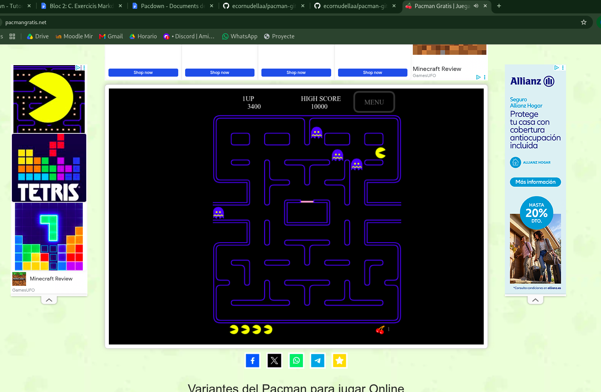

# PACMAN

Pac-Man es un icónico videojuego arcade de 1980 creado por el diseñador Toru Iwatani para la empresa Namco.

- El protagonista: Es un círculo amarillo con una boca que se abre y se cierra continuamente, inspirado en la forma de una pizza a la que le falta una porción.

- El objetivo: Recorrer un laberinto comiendo todos los puntos pequeños (pills), frutas y premios especiales.

- Los enemigos: Cuatro fantasmas de colores (Blinky, Pinky, Inky y Clyde) persiguen al jugador. Si Pac-Man come una píldora especial (power pellet), puede devorar a los fantasmas temporalmente.

[Jugar online a pacman](https://pacmangratis.net/.)

# Link Info Fantasmes!

[Info Inky](inky.md)

[Info Pinky](pinky.md)

[Info Blinky](blinky.md)
[Link a compte github](https://github.com/ecornudellaa/pacman-git)

